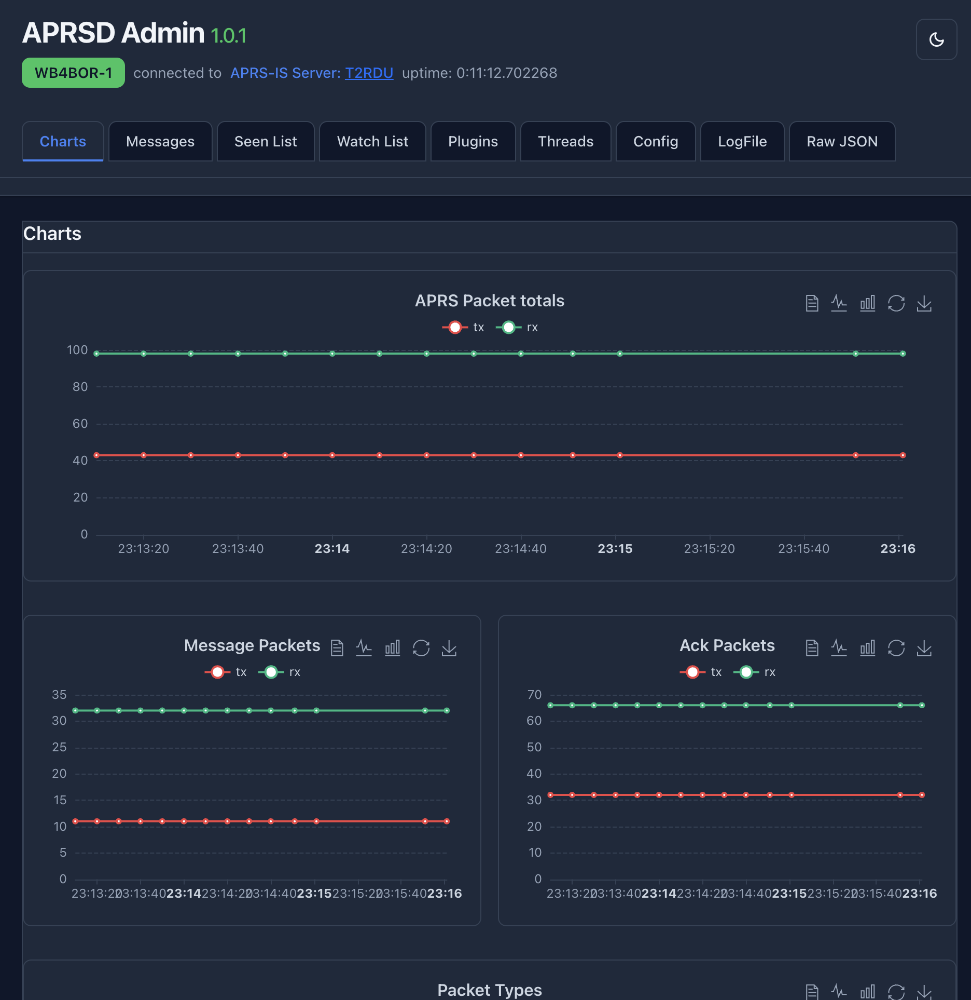

APRSD Admin Web Interface
=========================

.. image:: https://img.shields.io/pypi/v/aprsd-admin-extension.svg
   :target: https://pypi.org/project/aprsd-admin-extension/
   :alt: PyPI

.. image:: https://img.shields.io/pypi/status/aprsd-admin-extension.svg
   :target: https://pypi.org/project/aprsd-admin-extension/
   :alt: Status

.. image:: https://img.shields.io/pypi/pyversions/aprsd-admin-extension
   :target: https://pypi.org/project/aprsd-admin-extension
   :alt: Python Version

.. image:: https://img.shields.io/pypi/l/aprsd-admin-extension
   :target: https://opensource.org/licenses/Apache%20Software%20License%202.0
   :alt: License

.. image:: https://img.shields.io/readthedocs/aprsd-admin-extension/latest.svg?label=Read%20the%20Docs
   :target: https://aprsd-admin-extension.readthedocs.io/
   :alt: Read the documentation at https://aprsd-admin-extension.readthedocs.io/

.. image:: https://img.shields.io/badge/pre--commit-enabled-brightgreen?logo=pre-commit&logoColor=white
   :target: https://github.com/pre-commit/pre-commit
   :alt: pre-commit

----

..

   [!WARNING]
   Legal operation of this software requires an amateur radio license and a valid call sign.

   [!NOTE]
   Star this repo to follow our progress! This code is under active development, and contributions are both welcomed and appreciated. See `CONTRIBUTING.md <https://github.com/hemna/aprsd-admin-extension/blob/master/CONTRIBUTING.md>`_ for details.

Features
--------

The APRSD Admin Web Interface provides a comprehensive web-based administration and monitoring
tool for your APRSD daemon. Key features include:

* **Real-time Statistics**\ : View live APRSD statistics including message counts, connection status,
  and system metrics
* **Live Log Monitoring**\ : Stream APRSD logs in real-time via WebSocket connection
* **Interactive Charts**\ : Visualize statistics with dynamic charts and graphs
* **Configuration Viewer**\ : View your current APRSD configuration in a readable format
* **Message Sending**\ : Send APRS messages directly from the web interface
* **APRS Symbol Visualization**\ : View APRS symbols and their meanings
* **Plugin Management**\ : See installed plugins and their status
* **HTTP Basic Authentication**\ : Secure access with username/password authentication

Requirements
------------

* ``aprsd >= 4.2.4``
* A running APRSD instance (or run the admin interface standalone)

Installation
------------

You can install *APRSD Admin Interface* via `pip <https://pip.pypa.io/>`_ from `PyPI <https://pypi.org/>`_\ :

.. code-block:: console

   $ pip install aprsd-admin-extension

Or using ``uv``\ :

.. code-block:: console

   $ uv pip install aprsd-admin-extension

Configuration
-------------

Before using the admin interface, you need to configure it in your APRSD configuration file.
Generate a sample configuration file if you haven't already:

.. code-block:: console

   $ aprsd sample-config

This will create a configuration file at ``~/.config/aprsd/aprsd.conf`` (or ``aprsd.yml``\ ).

Admin Interface Configuration
^^^^^^^^^^^^^^^^^^^^^^^^^^^^^

Add the following section to your APRSD configuration file to configure the admin interface:

.. code-block:: yaml

   [aprsd_admin_extension]
   # Enable the Admin Web Interface (default: True)
   web_enabled = True

   # IP address to listen on (default: 0.0.0.0 - all interfaces)
   # Use 127.0.0.1 to only allow local connections
   web_ip = 0.0.0.0

   # Port to listen on (default: 8001)
   web_port = 8001

   # Admin username for HTTP Basic Authentication (default: admin)
   user = admin

   # Admin password for HTTP Basic Authentication (default: password)
   # IMPORTANT: Change this from the default!
   password = your_secure_password_here

Security Considerations
^^^^^^^^^^^^^^^^^^^^^^^

**Important**\ : The default password is ``password``. You **must** change this in production!

For better security:

* Use a strong, unique password
* Consider binding to ``127.0.0.1`` instead of ``0.0.0.0`` if you only need local access
* Use a reverse proxy (nginx, Apache) with HTTPS if accessing over the internet
* Consider firewall rules to restrict access to the admin port

Example Configuration
^^^^^^^^^^^^^^^^^^^^^

Here's a complete example configuration for a secure local-only setup:

.. code-block:: yaml

   [aprsd_admin_extension]
   web_enabled = True
   web_ip = 127.0.0.1  # Only allow local connections
   web_port = 8001
   user = admin
   password = your_secure_password_here

Usage
-----

Starting the Admin Interface
^^^^^^^^^^^^^^^^^^^^^^^^^^^^

Once installed and configured, start the admin interface with:

.. code-block:: console

   $ aprsd admin web

The admin interface will start and be accessible at ``http://localhost:8001`` (or the IP/port you configured).

Accessing the Interface
^^^^^^^^^^^^^^^^^^^^^^^

#. Open your web browser and navigate to ``http://YOUR_IP:8001`` (replace ``YOUR_IP`` with your server's IP or ``localhost`` for local access)
#. You'll be prompted for HTTP Basic Authentication
#. Enter the username and password you configured in ``aprsd.conf``
#. You'll see the admin dashboard with statistics, logs, and configuration

Using the Interface
^^^^^^^^^^^^^^^^^^^

The admin interface provides several tabs:

* **Dashboard**\ : Overview of APRSD statistics, connection status, and system metrics
* **Logs**\ : Real-time log streaming with filtering capabilities
* **Configuration**\ : View your current APRSD configuration
* **Messages**\ : Send APRS messages directly from the interface
* **Plugins**\ : View installed plugins and their status

Running Standalone
^^^^^^^^^^^^^^^^^^

The admin interface can run standalone without a full APRSD server instance. However, some features
(such as sending messages) require a running APRSD server.

Verifying It's Working
^^^^^^^^^^^^^^^^^^^^^^

After starting the admin interface, check the logs for messages like:

.. code-block::

   INFO: APRSD Started version: X.X.X
   INFO: Registering LogMonitorThread

Then open your browser to ``http://localhost:8001`` (or your configured address) and you should see
the admin interface login prompt.

For more details, see the `Command-line Reference <https://aprsd-admin-extension.readthedocs.io/en/latest/usage.html>`_.

Contributing
------------

Contributions are very welcome. To learn more, see the `Contributor
Guide <CONTRIBUTING.rst>`_.

License
-------

Distributed under the terms of the `Apache Software License 2.0
license <https://opensource.org/licenses/Apache%20Software%20License%202.0>`_\ ,
*APRSD Admin Interface* is free and open source software.

Issues
------

If you encounter any problems, please `file an
issue <https://github.com/hemna/aprsd-admin-extension/issues>`_ along with
a detailed description.

Credits
-------

This project was generated from `\@hemna <https://github.com/hemna>`_\ \'s
APRSD Extension Python
`Cookiecutter <https://github.com/audreyr/cookiecutter>`_ template.

Activity
--------

.. image:: https://repobeats.axiom.co/api/embed/25f696ef8f6fe3586931a33d5c491428d872c152.svg
   :target: https://repobeats.axiom.co/api/embed/25f696ef8f6fe3586931a33d5c491428d872c152.svg
   :alt: Alt
